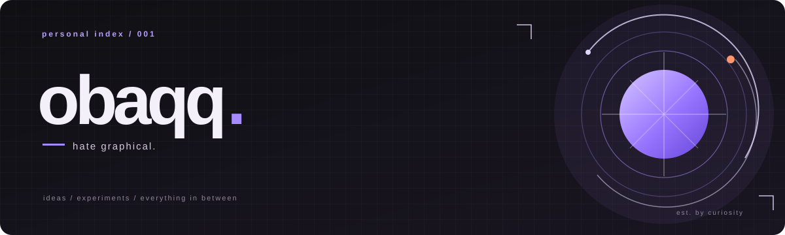

<!--
  obaqq — GitHub profile
  Custom visual identity · Editorial / experimental
-->

 

### INDEPENDENT BY DESIGN. CURIOUS BY DEFAULT.

I make things, explore ideas, and follow interesting problems.

[**Website ↗**](https://crashing.ltd/) &nbsp; / &nbsp; [**GitHub ↗**](https://github.com/obaqq) &nbsp; / &nbsp; [**CRASHING LTD ↗**](https://github.com/crashing-ltd)

 

### 04 / GITHUB IN NUMBERS

 

Live cards based on available GitHub activity and repository data.

---

### THE INTERNET IS STILL A PLACE TO MAKE THINGS.

If something here catches your eye, take a look around.

[**Browse my repositories ↗**](https://github.com/obaqq?tab=repositories)

 

obaqq · [crashing.ltd](https://crashing.ltd/) · Made with curiosity.

